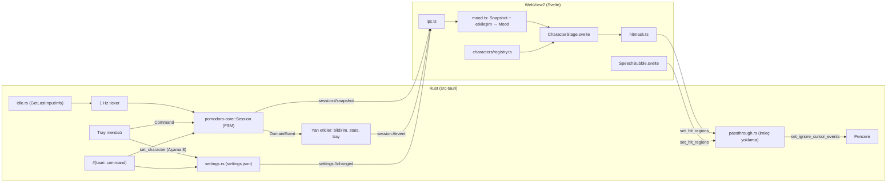
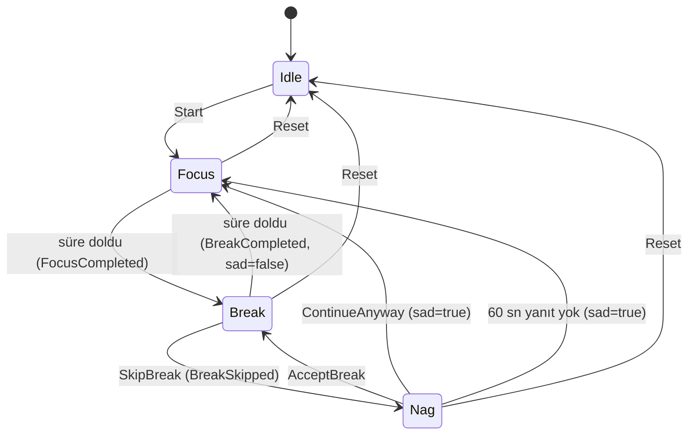
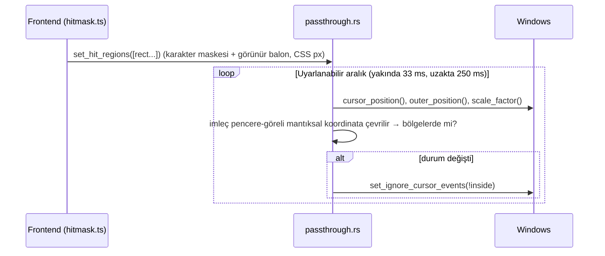
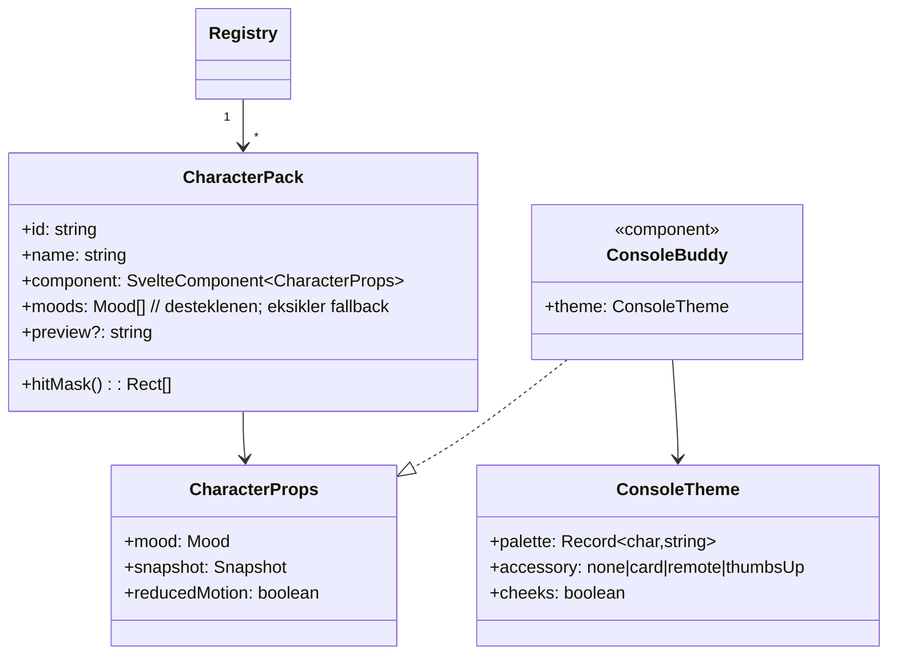

# Pomodoro & Movement Companion — Yerel (Windows) Geliştirme Planı

> [!NOTE]
> Bu doküman kendi başına yeterli olacak şekilde yazıldı. Yeni bir yerel projede açıp agent'a **"Bu planı uygula"** demeniz yeterli.

## Hedef

Masaüstünde **her zaman üstte**, **çerçevesiz ve şeffaf** duran, **retro el konsolu görünümlü** küçük bir karakter. Karakter **25 dk odak / 5 dk hareket molası** döngüsünü bir **durum makinesiyle** yönetir.

- **Platform:** Windows 10/11
- **Kaynak hedefi:** boştayken CPU ≈ %0, RAM < ~60–80 MB (WebView2 dahil)
- **Arayüz dili:** Türkçe

**MVP kapsamı:**
- Karakter dışındaki şeffaf alanlar tıklamayı **alttaki pencerelere geçirir** (click-through).
- Sürükleme **yalnızca karakterden tutarak** yapılır.
- Sistem bildirimleri ve ses
- Tray menüsü
- Günlük istatistiğin yerel olarak kaydedilmesi
- Mola atlanınca karakterin üzülüp ısrar etmesi
- **Karakter paketi mimarisi:** MVP'de tek karakter var, ama ileride tray'den karakter değiştirmeye hazır.

## Teknoloji Seçimi

| Katman | Seçim | Neden |
|---|---|---|
| Kabuk | **Tauri v2** | Sistemin WebView2'sini kullanır. Kurulum ~5–10 MB. Şeffaf, çerçevesiz ve always-on-top pencereyi yerleşik destekler. |
| Zamanlayıcı + oturum FSM | **Rust**, ayrı `pomodoro-core` crate (Tauri bağımlılığı yok) | Arka plandaki webview JS zamanlayıcılarını yavaşlatabilir, Rust'ta bu sorun yok. Deterministik ve birim testi yazılabilir. |
| Click-through | Rust'ta **uyarlanabilir imleç yoklama** + `set_ignore_cursor_events` + karakter **hit-mask**'i | WebView2'de piksel bazlı saydam hit-test yok. Tauri'de yaygın "desktop pet" çözümü bu. |
| UI | **Svelte 5 + TypeScript + Vite** | Sanal DOM yok, çıktısı çok küçük. |
| Karakter | **Kodla tanımlı piksel-art sprite'lar** (ASCII harita → renk başına tek SVG `<path>`) | Referanstaki retro görünümü verir. Dosya asset'i yok. Tema = palet + aksesuar, bu yüzden karakter değiştirmek ucuz. |
| Ses | **WebAudio osilatör chime** | Ses dosyasına gerek yok. |
| Tauri eklentileri | `notification`, `window-state`, `single-instance`, yerleşik `tray-icon` | Bildirim, pencere konumunu hatırlama, tek örnek çalışma, tray menüsü. |
| Kalıcı veri | `serde_json` → `%APPDATA%\com.pomodoro.companion\{stats,settings}.json` | Basit, yerel, ek bağımlılık yok. |
| Test | `cargo test` (core), **Vitest** (mood, etkileşim, sprite derleyici, hit-mask), `svelte-check` | |

## Varsayılan Kararlar (değiştirilebilir)

> [!IMPORTANT]
> 1. Süreler **sabit 25/5**. Ayar arayüzü ve uzun mola yok. Değerler `Config` içinde tutulur.
> 2. **Molada girdi kontrolü dahil:** Molada son 10 sn içinde klavye/fare kullanılmışsa karakter "Hey, masadan kalk! 🚶" der. Windows `GetLastInputInfo` kullanılır.
> 3. Arayüz dili **Türkçe**.
> 4. MVP'de **tek karakter** ("Mint", aşağıda). Diğer 3 tema ve tray'den karakter seçimi **Aşama 8**'de. Mimari MVP'den itibaren buna hazır.
> 5. Git: yerel `git init`. GitHub/CI isteğe bağlı (Aşama 9).

> [!CAUTION]
> Referans görseller bilinen karakter ve markalardan (Adventure Time "BMO", Game Boy/Famicom) esinleniyor. Karakterler **özgün** tasarlanacak: logo, marka adı veya birebir kopya kullanılmayacak, isimler özgün olacak. Uygulamayı yalnızca kişisel kullanıyorsanız risk düşük. Dağıtacaksanız bu kural önemli.

---

## Aşama 0 — Ön Koşullar (Windows) ✅

| Durum | Araç | Kurulum | Kontrol |
|---|---|---|---|
| ✅ Hazır | Visual Studio Build Tools 2022 | "Desktop development with C++" iş yükü (MSVC + Windows SDK) | `17.14.37827.9` (SDK `10.0.26100.0`) |
| ✅ Hazır | Rust | https://rustup.rs → `stable-x86_64-pc-windows-msvc` | `cargo 1.99.1` |
| ✅ Hazır | Node.js LTS (≥ 20) | `winget install OpenJS.NodeJS.LTS` | `v24.19.0` (npm `11.17.0`) |
| ✅ Hazır | WebView2 Runtime | Windows 11'de yüklü. Windows 10'da gerekirse Evergreen Runtime'ı kurun. | `156.0.4314.58` |
| ✅ Hazır | Git (Aşama 1 `git init` için) | `winget install Git.Git` | `git 2.56.0.windows.4` |

```powershell
winget install Microsoft.VisualStudio.2022.BuildTools   # sonra C++ iş yükünü seçin
winget install Rustlang.Rustup
winget install OpenJS.NodeJS.LTS
```

---

## Mimari



**Temel ilkeler:**
1. Zamanlayıcının tek doğruluk kaynağı Rust tarafı.
2. **Davranış (Mood) ile görünüm (karakter paketi) ayrı.** FSM ve mood mantığı hangi karakterin seçili olduğunu bilmez. Karakter paketleri yalnızca `Mood → görüntü` eşlemesini sağlar.
3. Click-through kararını Rust verir. Frontend yalnızca hangi bölgelerin tıklanabilir olduğunu bildirir.

### Oturum Durum Makinesi (`pomodoro-core`)



- `paused`, `Focus` ve `Break` içinde bir bayrak, ayrı bir durum değil. Duraklatınca `remaining` saklanır. Devam edince yeni `deadline = now + remaining` hesaplanır.
- **Süre kayması olmaz:** Her `tick(now)` çağrısında `deadline - now` hesaplanır, tick sayılmaz. Bilgisayar uykudan uyanınca süre aşılmışsa tek bir geçiş yapılır.
- Geçersiz komutlar yok sayılır ve boş `Vec` döner.
- `POMODORO_FAST=1` ortam değişkeni süreleri **25 sn / 5 sn / nag 10 sn** yapar.

### Karakter Mood Eşlemesi (`mood.ts`, saf fonksiyon, öncelik sırasıyla)

| # | Koşul | Mood | Ortak animasyon fikri |
|---|---|---|---|
| 1 | Sürükleniyor | `dragged` | Bacaklar sallanır, ekranda `> <` |
| 2 | Son 1 sn'de dürtüldü | `poked` | Squash, ekranda `^ ^`, balonda kalan süre |
| 3 | `FocusCompleted` olayından sonraki 3 sn | `celebrate` | Zıplama + konfeti pikselleri |
| 4 | `Nag` | `nag` | Ekranda gözyaşı. Balon: "Lütfen 5 dk yürü 🥺" + [Tamam, yürüyorum] [Yine de çalış] |
| 5 | `paused` | `sleeping` | Ekranda `- -`, "Zzz" pikselleri, ekran kararır |
| 6 | `Break` ve `input_recent` | `warning` | Eller belde, ekranda `ò ó`. Balon: "Hey, masadan kalk! 🚶" |
| 7 | `Break` | `walking` | Yerinde yürüme, kol sallama |
| 8 | `Focus` ve `sad` | `focus_sad` | Ekranda düşük kaşlar, yavaş nefes |
| 9 | `Focus` | `focus` | Sakin nefes, ara sıra göz kırpma, ekranda küçük ilerleme çubuğu |
| 10 | `Idle` | `idle` | Nefes + göz kırpma, el sallama. Balon: "Başlayalım mı? (çift tıkla)" |

**Etkileşimler (yalnızca karakter piksellerinin üzerinde):**
- **Tek tık:** dürtme tepkisi + kalan süre.
- **Çift tık:** Başlat / Duraklat / Devam.
- **Basılı tutup sürükleme** (4 px eşiği): `startDragging()`.

Konuşma balonu ve butonları tıklanabilir ama sürüklenemez. Bunların dışındaki her yer tıklamayı alttaki pencereye geçirir.

---

## Click-through Tasarımı (MVP)

> [!NOTE]
> **Yoruma yanıt:** Evet, önceki plan bunu kastediyordu: karakterin etrafındaki görünmez dikdörtgen alttaki pencerelere tıklamayı engellerdi. Bu sürümde düzeltme **MVP kapsamında**. Karakter ve görünür konuşma balonu dışındaki her piksel tıklamayı alttaki uygulamaya geçirir. Sürükleme yalnızca karakterin kendisinden tutarak yapılır.

**Neden basit değil:** WebView2 şeffaf piksellerde bile tıklamayı yakalar. Windows'un katmanlı pencere hit-test'i WebView2 kompozisyonuyla çalışmaz. Tauri'nin sunduğu araç `set_ignore_cursor_events(bool)`, ve bu **tüm pencere için** geçerli. Ayrıca pencere tıklamaları geçirirken webview mouse olayı almaz, yani "imleç karakterin üstüne geldi" bilgisi frontend'den gelemez.

**Çözüm:** İmleç konumunu Rust tarafı yoklar ve kararı o verir.



- **Hit bölgeleri (`hitmask.ts`):** Seçili karakterin tüm poz katmanlarının (kollar, bacaklar, aksesuar) **birleşik opak piksel maskesi** sprite verisinden bir kez hesaplanır. Maske satır bazlı run-length ile **dikdörtgen listesine** çevrilir (≈30–50 dikdörtgen). Sonuç piksel hassasiyetine yakın ve animasyon karelerinden bağımsız sabit bir maske olur. Balon görünürken `getBoundingClientRect()` değeri listeye eklenir. Liste yalnızca karakter değişince, balon açılıp kapanınca veya yerleşim değişince (`ResizeObserver`) gönderilir.
- **Yoklama maliyeti:**
  - İmleç pencere dikdörtgeninin 48 px çevresi dışındaysa 4 Hz.
  - İçindeyse 30 Hz.
  - Sadece durum değişince `set_ignore_cursor_events` çağrılır.

  `GetCursorPos` çok ucuz bir çağrı olduğu için CPU ≈ %0 hedefi korunur.
- **Güvenli başlangıç:** Frontend ilk bölgeleri gönderene kadar pencere tamamen tıklanabilir kalır. Pencere gizliyken yoklama durur.
- **Sürükleme:** `pointerdown` yalnızca karakter SVG'sinde dinlenir. Sürükleme sırasında (Windows modal taşıma döngüsü) imleç karakterin üstünde olduğundan pencere etkileşimli kalır. Bölgeler pencereye göreli olduğu için taşıma sonrası güncelleme gerekmez.
- **DPI:** Bölgeler CSS (mantıksal) px olarak gönderilir. Rust tarafında `(cursor_phys - outer_pos_phys) / scale_factor` hesaplanıp karşılaştırılır. Çoklu monitörde farklı DPI değerleri doğru ele alınır.
- **Saf mantık testlenebilir:** `pomodoro-core::hit::{Rect, HitRegions::contains, poll_interval}` Tauri'den bağımsızdır ve birim testleri yazılır.

---

## Karakter Tasarımı


**Referanstan alınan ortak dil:**
- Dikey dikdörtgen, köşeleri yuvarlatılmış bir **el konsolu gövdesi**
- Üst yarıda **yüz görevi gören ekran**: basit nokta gözler, küçük gülümseme, bazılarında pembe/kırmızı yanaklar
- Alt yarıda **D-pad** ve renkli **A/B butonları**
- **İnce çubuk kollar** ve kısa bacaklar
- Koyu dış hat, hafif gölgeli piksel-art doku

Ekran hem yüz hem bilgi alanı: odakta minik ilerleme çubuğu, uykuda karartma.

### Tema seti (özgün isimler)

| ID | İsim | Gövde / ekran | Ayırt edici öğe | Kapsam |
|---|---|---|---|---|
| `mint` | **Mint** | Turkuaz gövde, açık yeşil ekran | Elinde beyaz not kartı (kartta mola mesajı/süre) | **MVP (varsayılan)** |
| `gece` | **Gece** | Lacivert gövde, mavi ekran, kırmızı yanaklar | Kırmızı A/B butonları | Aşama 8 |
| `retro` | **Retro** | Beyaz üst / siyah alt gövde | Elinde küçük kumanda | Aşama 8 |
| `limon` | **Limon** | Sarı gövde, gri ekran | `celebrate` mood'unda başparmak yukarı | Aşama 8 |

### Kodla piksel-art yaklaşımı
- Tuval **32×40 piksel**, pencere içinde **×5** ölçekte (160×200 CSS px). SVG'de `shape-rendering="crispEdges"`, `image-rendering: pixelated` kullanılır.
- Her karakter **ASCII katmanlarla** tanımlanır. Her karakter bir palet anahtarına karşılık gelir. Örnek (temsili, gövde üst kısmı):
  ```ts
  // characters/console/sprites.ts
  export const body = [
    '....KKKKKKKKKKKKKKKKKKKKKK....',
    '...KBBBBBBBBBBBBBBBBBBBBBBK...',
    '...KBKKKKKKKKKKKKKKKKKKKKBK...',
    '...KBKSSSSSSSSSSSSSSSSSSKBK...',   // S = ekran
    '...KBKSSSSSSSSSSSSSSSSSSKBK...',
    // ... D-pad: 'D', A/B butonları: 'A' 'b', gölge: 'h'
  ];
  export const faces: Record<FaceId, string[]> = { happy: [...], blink: [...], sad: [...], sleep: [...], squint: [...], angry: [...] };
  export const arms = { rest: [...], wave1: [...], wave2: [...], hips: [...], holdCard: [...], thumbsUp: [...] };
  export const legs = { stand: [...], walk1: [...], walk2: [...], dangle: [...] };
  ```
- **Sprite derleyici (`lib/pixel/compile.ts`):** ASCII + palet girdisinden **renk başına tek `<path d>`** üretir (yatay run-length, `M x y h n v1 h-n z`). Böylece karakter başına DOM'da ~10–15 eleman olur, binlerce `<rect>` olmaz. Sonuç karakter ve kare başına bir kez hesaplanıp memoize edilir.
- **Animasyon:**
  - **Kare değişimi:** Yüz, kol ve bacak katmanları kısa bir JS döngüsüyle değişir (yürüme 4 fps, göz kırpma rastgele 3–6 sn). Döngü yalnız mood bunu gerektirdiğinde çalışır.
  - **Gövde hareketi:** Nefes, zıplama ve squash CSS `transform` ile yapılır. Retro his için `steps()` zamanlaması kullanılır.
  - **Kısıtlar:** `prefers-reduced-motion` desteklenir. `document.hidden` olduğunda döngü durur.
- **Tasarım süreci:** Agent önce `mint` sprite'larını yazar ve `npm run dev` + `/#gallery` sayfasında tüm mood'ları yan yana gösterir. Siz görsel onay verdikten sonra entegrasyona geçilir.

---

## Karakter Paketi Mimarisi (tray'den karakter değiştirmeye hazır)



- **Tek doğruluk kaynağı katalog:** `src/characters/catalog.json` → `[{ "id": "mint", "name": "Mint" }, ...]`.
  - Rust bunu `include_str!` ile derleme zamanında okur: tray alt menüsünü kurmak ve `set_character` id'sini doğrulamak için.
  - TS aynı dosyayı import eder. Registry açılışta her katalog girdisinin bir paketle eşleştiğini doğrular.
- **Registry (`characters/registry.ts`):** `import.meta.glob('./*/pack.ts', { eager: true })` ile paketleri otomatik toplar. Bilinmeyen id gelirse `mint` paketine düşer.
- **Paket türleri:** Konsol ailesinin tüm temaları tek bir parametrik `ConsoleBuddy.svelte` bileşenini ve **farklı `ConsoleTheme`** değerlerini kullanır. Yeni tema eklemek için palet ve aksesuar yeterli. Tamamen farklı bir karakter (örn. kedi) için yeni bir bileşen yazılır. Bileşen `CharacterProps` sözleşmesine uyduğu sürece başka hiçbir şey değişmez.
- **Mood fallback:** Paket bir mood'u desteklemiyorsa `MOOD_FALLBACK` tablosu kullanılır (örn. `warning → nag → idle`).
- **Ayarlar (Rust, MVP'de var):** `pomodoro-core::settings::Settings { version: u32, character_id: String }` → `settings.json`.
  - Komutlar: `get_settings`, `set_character(id)`. `set_character` id'yi doğrular, kaydeder ve `settings://changed` olayını yayar.
  - Frontend olayı dinler, `CharacterStage` paketi değiştirir ve yeni hit-mask Rust'a gönderilir.
  - `version` alanı ileride ayar şeması değişirse göç (migration) için tutulur.
- **Aşama 8'de yalnızca şunlar eklenecek:** 3 yeni `pack.ts`/tema, `catalog.json` girdileri ve tray'de `Karakter ▸` alt menüsü (`CheckMenuItem` listesi, seçili olan işaretli). Altyapı MVP'de hazır olduğu için başka değişiklik gerekmez.

---

## Proje Yapısı

```
Pacerx/
├─ Cargo.toml                         # workspace
├─ package.json, vite.config.ts, svelte.config.js, tsconfig.json, index.html
├─ crates/pomodoro-core/src/
│  ├─ lib.rs, session.rs, stats.rs
│  ├─ settings.rs                     # Settings + load/save + validate(id, catalog)
│  └─ hit.rs                          # Rect, HitRegions::contains, poll_interval
├─ src-tauri/
│  ├─ Cargo.toml, build.rs, tauri.conf.json, capabilities/default.json, icons/
│  └─ src/{main.rs, lib.rs, effects.rs, tray.rs, idle.rs, passthrough.rs, catalog.rs}
└─ src/
   ├─ main.ts, App.svelte, app.css
   ├─ characters/
   │  ├─ catalog.json
   │  ├─ registry.ts, types.ts        # CharacterPack, CharacterProps, MOOD_FALLBACK
   │  ├─ console/                     # konsol ailesi (paylaşılan)
   │  │  ├─ ConsoleBuddy.svelte, sprites.ts, theme.ts, console.css
   │  └─ mint/pack.ts                 # MVP; Aşama 8: gece/, retro/, limon/
   └─ lib/
      ├─ types.ts, ipc.ts, mock.ts, sound.ts
      ├─ interaction.ts (+test), hitmask.ts (+test)
      ├─ pixel/compile.ts (+test)
      ├─ mood.ts (+test)
      ├─ CharacterStage.svelte, SpeechBubble.svelte, Gallery.svelte (yalnız dev)
```

---

## Aşama 1 — İskelet ✅

- [x] `Pacerx` kök dizininde Tauri v2 + Svelte 5 + TypeScript + Vite proje iskeleti oluşturuldu
- [x] `@tauri-apps/plugin-notification` ve `vitest` eklendi (`npm install`, `npm run check`, `npm run build` doğrulandı)
- [x] Kök `Cargo.toml` workspace ve `crates/pomodoro-core` oluşturuldu
- [x] `src-tauri/Cargo.toml` bağımlılıkları (`tray-icon`, `notification`, `window-state`, `single-instance`, `serde`, `serde_json`, `chrono`, `tokio`, `windows`) eklendi ve `cargo check --workspace` doğrulandı
- [x] `git init` çalıştırıldı

#### [NEW] Cargo.toml (kök workspace)
```toml
[workspace]
members = ["crates/pomodoro-core", "src-tauri"]
resolver = "2"

[profile.release]
opt-level = "s"
lto = true
codegen-units = 1
panic = "abort"
strip = true
```
`src-tauri/Cargo.toml` dosyasına `pomodoro-core = { path = "../crates/pomodoro-core" }` eklenir. `package.json` script'lerine `"test": "vitest run"` ve `"check": "svelte-check"` eklenir.

**✅ Kontrol noktası:** `npm run tauri dev` şablon penceresini açmalı.

---

## Aşama 2 — `pomodoro-core` (saf Rust) ✅

- [x] `crates/pomodoro-core/src/session.rs` (`Phase`, `Command`, `DomainEvent`, `Config`, `Snapshot`, `Session` FSM + 6 birim testi)
- [x] `crates/pomodoro-core/src/stats.rs` (`DailyStats`, `StatsStore`, atomik `save` + `load` + 2 birim testi)
- [x] `crates/pomodoro-core/src/settings.rs` (`Settings`, `with_character`, atomik `save` + `load` + 2 birim testi)
- [x] `crates/pomodoro-core/src/hit.rs` (`Rect`, `HitRegions`, `poll_interval` + 2 birim testi)
- [x] `cargo test -p pomodoro-core` (12/12 test geçti) ve `cargo clippy -p pomodoro-core -- -D warnings` doğrulandı

#### [NEW] session.rs
```rust
#[derive(Clone, Copy, Debug, PartialEq, Eq, Serialize)] #[serde(rename_all = "snake_case")]
pub enum Phase { Idle, Focus, Break, Nag }

#[derive(Clone, Copy, Debug, Deserialize)] #[serde(rename_all = "snake_case")]
pub enum Command { Start, TogglePause, SkipBreak, AcceptBreak, ContinueAnyway, Reset }

#[derive(Clone, Copy, Debug, PartialEq, Serialize)] #[serde(tag = "type", rename_all = "snake_case")]
pub enum DomainEvent { PhaseChanged { from: Phase, to: Phase }, FocusCompleted, BreakCompleted, BreakSkipped }

pub struct Config { pub focus: Duration, pub brk: Duration, pub nag_timeout: Duration } // standard(): 25m/5m/60s, fast(): 25s/5s/10s

#[derive(Clone, Debug, Serialize)]
pub struct Snapshot { pub phase: Phase, pub remaining_secs: u64, pub total_secs: u64, pub paused: bool, pub sad: bool, pub input_recent: bool }

impl Session {
    pub fn new(cfg: Config) -> Self;
    pub fn handle(&mut self, cmd: Command, now: Instant) -> Vec<DomainEvent>;
    pub fn tick(&mut self, now: Instant) -> Vec<DomainEvent>;
    pub fn snapshot(&self, now: Instant) -> Snapshot;
}
```

#### [NEW] stats.rs
`DailyStats { focus_completed, breaks_completed, breaks_skipped }` yapısı `BTreeMap<"YYYY-MM-DD", DailyStats>` içinde tutulur. Fonksiyonlar: `apply`, `today`, `load` (dosya yoksa veya bozuksa Default) ve atomik `save` (önce tmp'ye yazılır, sonra rename edilir).

#### [NEW] settings.rs
```rust
#[derive(Serialize, Deserialize, Clone)]
pub struct Settings { pub version: u32, pub character_id: String }
impl Default for Settings { fn default() -> Self { Self { version: 1, character_id: "mint".into() } } }
impl Settings {
    pub fn load(path: &Path) -> Self;
    pub fn save(&self, path: &Path) -> io::Result<()>;
    pub fn with_character(&self, id: &str, known: &[&str]) -> Result<Self, SettingsError>;
}
```

#### [NEW] hit.rs
```rust
#[derive(Deserialize, Clone, Copy)] pub struct Rect { pub x: f64, pub y: f64, pub w: f64, pub h: f64 }
pub struct HitRegions(Vec<Rect>);
impl HitRegions {
    pub fn contains(&self, x: f64, y: f64) -> bool;
    pub fn full(w: f64, h: f64) -> Self; // güvenli başlangıç
}
/// İmleç pencerenin `margin` kadar genişletilmiş dikdörtgeni içindeyse hızlı, değilse yavaş aralık.
pub fn poll_interval(cursor_rel: (f64, f64), win: (f64, f64), margin: f64) -> Duration; // 33ms / 250ms
```

#### Testler
- **Session:** tam döngü, pause/resume, uykudan dönüş, Nag dalları ve timeout, `sad` sıfırlama, geçersiz komutlar, Reset.
- **Stats:** sayaçlar, JSON round-trip, bozuk dosyada Default dönmesi.
- **Settings:** varsayılan değer, bilinmeyen id reddi, round-trip.
- **Hit:** kenar ve köşe noktaları, boş liste, `poll_interval` sınırları.

**✅ Kontrol noktası:** `cargo test -p pomodoro-core` ve `cargo clippy -p pomodoro-core -- -D warnings` temiz geçmeli.

---

## Aşama 3 — Tauri Kabuğu ✅

- [x] `src-tauri/tauri.conf.json` (200×270, şeffaf, çerçevesiz, alwaysOnTop, skipTaskbar, NSIS bundle)
- [x] `src-tauri/capabilities/default.json` (`allow-start-dragging`, `allow-hide`, `allow-show`, `notification:default`)
- [x] `src-tauri/src/catalog.rs` ve `src/characters/catalog.json`
- [x] `src-tauri/src/idle.rs` (Windows `GetLastInputInfo` + `GetTickCount`, etkileşim sonrası 10 sn bastırma)
- [x] `src-tauri/src/passthrough.rs` (uyarlanabilir 33ms / 250ms imleç yoklama, DPI ölçekleme, güvenli fallback)
- [x] `src-tauri/src/effects.rs` (bildirimler, `stats.json` kaydı, `session://event` yayını, tray güncelleme)
- [x] `src-tauri/src/tray.rs` (`build_menu`, sol tıkla göster/gizle, dakika/faz değişiminde tooltip güncelleme)
- [x] `src-tauri/src/lib.rs` (`AppState`, 6 Tauri komutu, 1 Hz ticker, ilk açılışta sağ alt köşe konumlandırma)
- [x] `cargo clippy --workspace -- -D warnings` ve `npm run check` doğrulandı

#### [MODIFY] tauri.conf.json
```json
{
  "productName": "Pomodoro Companion",
  "identifier": "com.pomodoro.companion",
  "app": {
    "windows": [{
      "label": "main", "title": "Pomodoro Companion",
      "width": 200, "height": 270, "resizable": false,
      "transparent": true, "decorations": false, "shadow": false,
      "alwaysOnTop": true, "skipTaskbar": true, "focus": false, "visible": false
    }],
    "security": { "csp": "default-src 'self'; style-src 'self' 'unsafe-inline'" }
  },
  "bundle": { "active": true, "targets": ["nsis"], "icon": ["icons/icon.ico", "icons/icon.png"] }
}
```
- Pencere `visible: false` ile başlar. Konum ayarlanınca `show()` çağrılır.
- İlk açılışta pencere çalışma alanının **sağ alt** köşesine konur (24 px kenar boşluğu). Sonraki açılışlarda konumu `window-state` geri yükler.

#### [MODIFY] capabilities/default.json
İzinler: `core:default`, `core:window:allow-start-dragging`, `core:window:allow-hide`, `core:window:allow-show`, `notification:default`.

#### [MODIFY] src/lib.rs
- `AppState { session, stats, settings, hit: Mutex<HitRegions>, paths }`
- Komutlar: `get_snapshot`, `send_command`, `get_today_stats`, `get_settings`, `set_character`, `set_hit_regions(rects: Vec<Rect>)`.
- **Ticker (1 Hz):** `session.tick` çağrılır. Molada `idle::secs_since_input` ile `input_recent` alanı doldurulur. Ardından `effects::apply` çalışır (bildirim, stats, `session://event`, tray). Pencere görünürse `session://snapshot` yayınlanır. `MissedTickBehavior::Skip` kullanılır.
- `send_command` da aynı `effects::apply` yolunu kullanır, böylece tray, UI ve ticker tutarlı kalır.

#### [NEW] src/passthrough.rs
```rust
pub fn spawn(app: AppHandle) {
    tauri::async_runtime::spawn(async move {
        let mut ignoring = false;
        loop {
            let win = match app.get_webview_window("main") { Some(w) => w, None => break };
            if !win.is_visible().unwrap_or(false) { sleep(Duration::from_millis(500)).await; continue; }
            let (cur, pos, scale, size) = (app.cursor_position(), win.outer_position(), win.scale_factor(), win.inner_size());
            // rel = (cur - pos) / scale  → mantıksal px
            let inside = state.hit.lock().contains(rel.x, rel.y);
            if inside == ignoring { let _ = win.set_ignore_cursor_events(!inside); ignoring = !inside; }
            sleep(hit::poll_interval(rel, logical_size, 48.0)).await;
        }
    });
}
```
Hata durumunda (örn. `cursor_position` başarısız olursa) pencere güvenli tarafta kalır: `set_ignore_cursor_events(false)`.

#### [NEW] src/catalog.rs
```rust
static CATALOG_JSON: &str = include_str!("../../src/characters/catalog.json");
pub struct CatalogEntry { pub id: String, pub name: String }
pub fn entries() -> &'static [CatalogEntry]; // OnceLock ile parse
```

#### [NEW] src/effects.rs
| Olay | Bildirim (başlık / gövde) | Diğer |
|---|---|---|
| `FocusCompleted` | "Mola zamanı! 🚶" / "5 dakika kalk, yürü, esne." | stats++, emit |
| `BreakCompleted` | "Odak zamanı 🍅" / "Yeni 25 dakika başladı." | stats++, emit |
| `BreakSkipped` | — (karakter balonla ısrar eder) | stats++, emit |

#### [NEW] src/tray.rs
Menü:
- **Başlat / Duraklat / Devam**
- **Molayı atla** (yalnız Break'te aktif)
- **Sıfırla**
- **Göster/Gizle**
- ayraç
- `Bugün: 🍅 3 · 🚶 2 · ⏭ 1` (devre dışı bilgi satırı)
- *(Aşama 8: `Karakter ▸` alt menüsü, `catalog::entries()` listesinden üretilir)*
- **Çıkış**

Menü bir `build_menu(app, &state)` fonksiyonuyla kurulur. Böylece karakter alt menüsü eklemek tek bir yerde yapılacak bir değişiklik olur. Tray ikonuna sol tıklama pencereyi gösterir/gizler. Tooltip dakika değişince güncellenir.

#### [NEW] src/idle.rs
`#[cfg(windows)]` altında `GetLastInputInfo` ve `GetTickCount` ile son girdiden bu yana geçen saniye hesaplanır. Diğer platformlarda `None` döner. Karakterle etkileşim (`send_command`) olduktan sonra uyarı 10 sn bastırılır.

**✅ Kontrol noktası:** `POMODORO_FAST=1` ile `npm run tauri dev` çalıştırılır. Pencerenin boş alanlarından alttaki uygulamaya tıklanabilmeli, şablon içeriğinin üstüne tıklanınca pencere etkileşimli olmalı. Tray çalışmalı ve 25 sn sonra bildirim gelmeli.

---

## Aşama 4 — Frontend Temeli ✅
- [x] **`lib/types.ts`:** Rust türlerinin TS karşılıkları (`Snapshot`, `Command`, `DomainEvent`, `DailyStats`, `Settings`, `Rect`).
- [x] **`lib/ipc.ts` + `mock.ts`:** `Api` arayüzü (`getSnapshot`, `send`, `todayStats`, `getSettings`, `setCharacter`, `setHitRegions`, `onSnapshot`, `onEvent`, `onSettings`, `startDragging`). Tarayıcıda mock backend kullanılır.
- [x] **`lib/interaction.ts`:** tık / çift tık / sürükleme ayrımı (4 px eşiği, 250 ms çift tık penceresi). Saf fonksiyon, zaman parametre olarak verilir, Vitest ile test edildi (4/4 test geçti).
- [x] **`lib/mood.ts`:** `deriveMood(snapshot, ix, now)` ve `bubbleFor(mood, snapshot)`. Öncelik tablosunun tamamı test edildi (10/10 test geçti).
- [x] **`lib/sound.ts`:** WebAudio chime'ları (yükselen ve alçalan). `AudioContext` ilk etkileşimde açılır.
- [x] **`App.svelte` (+ `SpeechBubble.svelte`, `CharacterStage.svelte`):** `html, body { background: transparent; overflow: hidden; user-select: none }`. Yerleşim: balon → `CharacterStage` → `mm:ss` → faz çubuğu.

  `mm:ss` etiketi ve faz çubuğu **hit bölgesine dahil değil**, yani üzerlerinden tıklama alttaki pencereye geçer. Bu yüzden ikisi karakterin hemen altında, okunaklı ama ince tutulur.

---

## Aşama 5 — Karakter Sistemi ve "Mint" ✅
- [x] 0. **`characters/vector/VectorConsoleBuddy.svelte` + `vector/theme.ts` (Ana Tasarım — Akıcı Vektör SVG):**
   - Retro el oyun konsolu (Game Boy / Mint turkuaz gövde, D-pad, A/B butonları, kartuş yuvası, güç LED'i) 240×240 vektör iskelet (`whole-rig`, `upper-body`, `left-arm`, `right-arm`, `left-leg`, `right-leg`, `ground-shadow`) ve 60 FPS akıcı eklem animasyonları (dambılsız doğal koşu/yürüyüş).
   - **Molaya yaklaşırken yorgunluk göstergeleri:** Odak süresinin son %20'sinde (ve `focus_sad`/`nag` durumlarında) ekranda yanıp sönen **düşük pil ikonu**, kademeli **göz kapağı düşmesi** ve konsol kenarından akan **ter damlası** animasyonu.
- [x] 1. **`lib/pixel/compile.ts` (+test):** ASCII katmanlar + palet → `{ color, d }[]`. Testler: tek piksel, yatay run, şeffaf karakter, bilinmeyen palet anahtarında hata.
- [x] 2. **`characters/types.ts`, `registry.ts`, `catalog.json`:** Sözleşme, `MOOD_FALLBACK` tablosu ve otomatik kayıt (`mint` [Akıcı Vektör] varsayılan + `mint_pixel` [Piksel-Art] değiştirilebilir seçenek).
- [x] 3. **`characters/console/sprites.ts`:**
   - Gövde (konsol, D-pad, A/B)
   - Yüz kareleri: `happy`, `blink`, `sad`, `tear`, `sleep`, `squint`, `angry`, `xx`
   - Kollar: `rest`, `wave1/2`, `hips`, `swing1/2`, `holdCard`, `thumbsUp`
   - Bacaklar: `stand`, `walk1/2`, `dangle`
   - Efektler: `zzz`, `confetti`
- [x] 4. **`characters/console/ConsoleBuddy.svelte` + `console.css`:** mood → {yüz, kol, bacak, efekt, gövde animasyon sınıfı} eşleme tablosu, kare döngüsü ve CSS transform'ları.
- [x] 5. **`characters/mint/pack.ts` & `characters/mint_pixel/pack.ts`:** `mint` (akıcı vektör) ve `mint_pixel` (piksel-art) paketleri + tray menüsünde `Karakter ▸` alt menüsü.
- [x] 6. **`lib/hitmask.ts` (+test):** paketin tüm katmanlarının birleşik maskesi → satır run'ları → dikdörtgenler.
- [x] 7. **`lib/CharacterStage.svelte`:** registry'den aktif paketi seçer, mood'u iletir. Paket değişince hit-mask'i gönderir. `pointerdown` olayını yalnız karakter SVG'sinde dinler.
- [x] 8. **`lib/Gallery.svelte` (`/#gallery`, yalnız dev):** tüm mood'ları ızgarada gösterir, karakter seçimi (`Mint (Vektör)` / `Mint (Piksel)`) ve `"Molaya Yakın (Düşük Pil + Ter)"` önizleme anahtarı sunar.

**✅ Kontrol noktası (görsel onay):**
- [x] `npm run dev` → `/#gallery` açılır ve görsel onay alındı.
- [x] `npm run check` ve `npm test` temiz geçti.

---

## Aşama 6 — Entegrasyon, Cila, Paketleme ✅
- [x] Tray ↔ UI ↔ ticker tutarlılığı (pencere gösterildiğinde anlık snapshot senkronizasyonu dahil).
- [x] Uyku/uyanma davranışı (`Instant` deadline + `MissedTickBehavior::Skip`).
- [x] Çoklu monitör ve farklı DPI (click-through doğruluğu ve Windows native sürükleme sonrası durum sıfırlama).
- [x] Paketleme (`npm run tauri build` → `target\release\bundle\nsis\Pomodoro Companion_0.1.0_x64-setup.exe` [1.26 MiB]).
- Paketleme:
  ```powershell
  npm run tauri build   # → target\release\bundle\nsis\Pomodoro Companion_0.1.0_x64-setup.exe
  ```

---

## Aşama 8 — (Atlandı / Gelecek Tasarımlar İçin Rehber Oluşturuldu) ✅
- [x] Piksel-art karakter paketi (`mint_pixel`) kullanıcı tercihiyle kaldırıldı; yalnızca akıcı vektör **Mint** karakteri bırakıldı.
- [x] Gelecekte yapay zeka ile yeni vektör karakterler tasarlayıp eklemek için tüm 10 modu, teknik kuralları ve hazır AI prompt şablonunu içeren [`CHARACTER_DESIGN_GUIDE.md`](./CHARACTER_DESIGN_GUIDE.md) oluşturuldu.

## Aşama 9 — GitHub + CI ✅
- [x] Kullanıcı ve geliştirici dokümantasyonu için [`README.md`](./README.md) oluşturuldu.
- [x] GitHub Actions üzerinde test ve Windows NSIS kurulum paketi üreten [`.github/workflows/ci.yml`](./.github/workflows/ci.yml) eklendi.

---

## Verification Plan

### Automated Tests
```powershell
cargo test -p pomodoro-core
cargo clippy --workspace -- -D warnings
npm run check
npm test
npm run tauri build
```

### Manual Verification (Windows)
Hızlı mod için:
```powershell
$env:POMODORO_FAST=1; npm run tauri dev
```
1. Pencere sağ altta, çerçevesiz, arka planı şeffaf ve diğer pencerelerin üstünde açılmalı. Görev çubuğunda simge olmamalı.
2. **Click-through:**
   - Karakterin yanındaki boşluğa, kollar ile gövde arasına ve `mm:ss` etiketine tıklayınca alttaki uygulama (örn. masaüstü ikonu) tepki vermeli.
   - Karakter piksellerine tıklayınca dürtme tepkisi gelmeli.
   - Nag balonundaki butonlar tıklanabilmeli.
   - Aynı testi %150 DPI'lı bir monitörde de tekrarlayın.
3. **Sürükleme:** Yalnızca karakterden tutunca pencere taşınmalı. Boş alandan sürüklemeye çalışınca alttaki pencere etkilenmeli. Uygulama yeniden açılınca konum hatırlanmalı.
4. Çift tık → odak başlar. Tekrar çift tık → `sleeping` mood'u.
5. 25 sn sonra bildirim, chime ve `celebrate` animasyonu gelmeli, ardından `walking`. Molada fare oynatılınca `warning` mood'u.
6. Tray → Molayı atla → `nag` balonu. "Yine de çalış" seçilince odak boyunca `focus_sad` mood'u görünmeli.
7. Tray'deki istatistik satırı ve `stats.json` doğru olmalı. `settings.json` içinde `character_id: "mint"` bulunmalı.
8. Normal modda boştayken CPU ≈ %0, bellek < ~80 MB. İmleç pencere yakınında gezinirken de CPU ihmal edilebilir düzeyde kalmalı.

> [!NOTE]
> `tauri dev` modunda bildirimler "Windows PowerShell" adıyla görünebilir. Kurulum yapılmış sürümde uygulama adıyla görünür.
